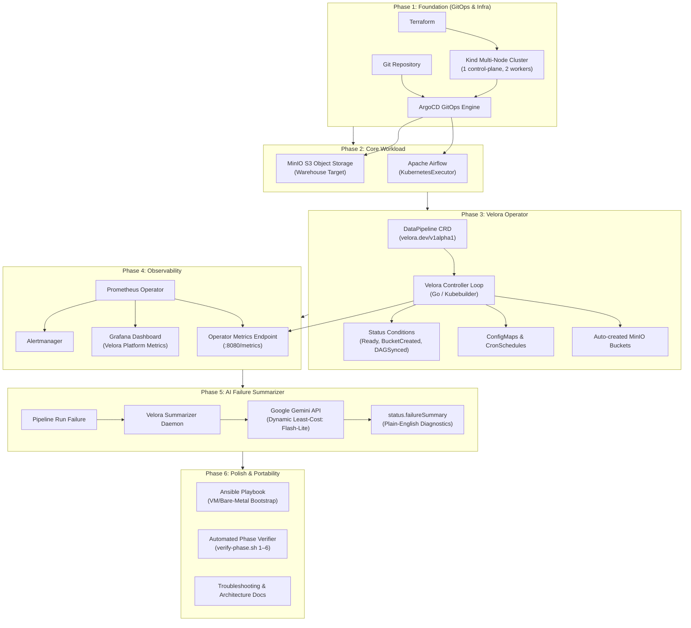

# Velora — Platform Phases Detailed Guide

This document provides a comprehensive, technical deep-dive into each of the six development phases of the **Velora GitOps Cloud-Native Data Platform**. It explains the purpose, architecture, key components, operational workflows, and verification criteria for every stage of the system.

---

## Architecture Overview

---

## Phase 1: Foundation (Infrastructure & GitOps)

### Purpose
Establish a reproducible, declarative local infrastructure baseline that mirrors modern enterprise Kubernetes environments without relying on paid public cloud providers.

### Key Components
1. **Kind (Kubernetes in Docker) Multi-Node Topology:**
   - **1 Control Plane Node (`velora-control-plane`):** Runs the API server, etcd, controller manager, and scheduler.
   - **2 Worker Nodes (`velora-worker`, `velora-worker2`):** Distributed node layout allowing realistic scheduling, affinity rules, and fault tolerance.
   - **Port Mappings:** Direct host port forwards configured in Kind config for port 80/443 (HTTP/HTTPS) and custom NodePorts (e.g. 30080 for ArgoCD, 30300 for Grafana, 30081 for Airflow, 30090 for MinIO).
2. **Infrastructure as Code (Terraform):**
   - Located in `infra/terraform`.
   - Uses the `tehcyx/kind` provider to declaratively define cluster creation, node roles, and container networking parameters.
3. **ArgoCD (GitOps Engine):**
   - Installed in namespace `argocd`.
   - Utilizes the **App-of-Apps** pattern (`gitops/argocd/apps/velora-app-of-apps.yaml`): a single root ArgoCD application that monitors the repository and synchronizes all downstream applications (`airflow`, `minio`, `velora-operator`, `prometheus-stack`).
   - Customized `repo-secret.yaml` with SSH/HTTPS credentials and TLS skip-verify for local Git remotes.
4. **Session Automation:**
   - `scripts/bootstrap.sh`: Automates prerequisite verification, image pre-loading, cluster spin-up, and ArgoCD initialization.
   - `scripts/env.sh`: Non-intrusive environment activator setting `PATH` and `KUBECONFIG` strictly for the active shell session.

### Verification Criteria (`verify-phase.sh 1`)
- Docker daemon active.
- `kind` and `kubectl` CLIs available in PATH.
- `velora` cluster exists with all 3 nodes in `Ready` state.
- ArgoCD server, repo-server, and application controllers running and healthy.

---

## Phase 2: Core Workload (Airflow & MinIO)

### Purpose
Deploy the data execution engine and S3-compatible data warehouse target using declarative Helm charts managed via ArgoCD.

### Key Components
1. **Apache Airflow (`airflow` namespace):**
   - **Executor:** Configured with `KubernetesExecutor`. Each scheduled task dynamically launches its own isolated Kubernetes pod, runs to completion, and cleans up, eliminating task crosstalk and dependency conflicts.
   - **Components:** `airflow-webserver` (UI), `airflow-scheduler` (orchestration scheduler), `airflow-triggerer` (async deferred tasks), and `airflow-postgresql` (state database).
   - **Security:** Standardized admin credentials (`admin` / `admin`).
2. **MinIO Object Storage (`minio` namespace):**
   - High-performance, S3-compatible distributed object storage.
   - Provides an S3 API endpoint (`minio.minio.svc.cluster.local:9000`) and a web console (`:9001` mapped to NodePort `30090`).
   - Acts as the storage target for raw, transformed, and analytical data buckets.
   - Custom init jobs using `pgsty/mc:latest` to configure default access credentials (`velora` / `velora-minio-secret`).

### Verification Criteria (`verify-phase.sh 2`)
- Airflow webserver and scheduler pods running and available.
- MinIO pod running with healthy service endpoints.
- Workload deployments in ready state.

---

## Phase 3: The Velora Operator (Custom Controller)

### Purpose
Eliminate manual infrastructure provisioning by introducing a Kubernetes-native Custom Resource Definition (`DataPipeline`) and custom operator that automates pipeline lifecycle management.

### Key Components
1. **`DataPipeline` CRD (`velora.dev/v1alpha1`):**
   - Declarative pipeline manifest specifying:
     - `schedule`: Cron expression for execution (e.g. `0 0 * * *`).
     - `source`: Upstream database connection type and secret reference (PostgreSQL, MySQL).
     - `destination`: Target MinIO bucket and format.
     - `image`: Custom container image for transformation runs.
2. **Velora Controller (`velora-operator` in `velora-system`):**
   - Built in Go using the **Kubebuilder v4** framework.
   - **Reconcile Loop Actions:**
     - **Secret Verification:** Verifies upstream database connection secrets exist.
     - **Bucket Provisioning:** Uses the MinIO/S3 Go SDK to automatically ensure the target destination bucket exists.
     - **Airflow DAG Synchronization:** Mounts pipeline definitions and triggers Airflow runs via REST API.
     - **Status Transitions:** Sets fine-grained `metav1.Condition` entries:
       - `BucketCreated`: `True` when MinIO bucket is verified.
       - `DAGSynced`: `True` when pipeline definition is synchronized with Airflow.
       - `Ready`: `True` when all dependencies are satisfied.
     - **Finalizer Management:** Implements `velora.dev/finalizer` to ensure clean deletion of child CronJobs and ConfigMaps before CR removal, while protecting MinIO buckets against accidental data loss.

### Verification Criteria (`verify-phase.sh 3`)
- `datapipelines.velora.dev` CRD registered in the Kubernetes API.
- Operator deployment and pod running in `velora-system`.
- Sample pipelines (`daily-sales-etl`, `hourly-events-etl`) reach `phase=Ready` with `BucketCreated=True` and `DAGSynced=True`.

---

## Phase 4: Observability & Telemetry

### Purpose
Provide comprehensive cluster-wide monitoring, custom operator metrics, and operational dashboards.

### Key Components
1. **Prometheus Operator (`kube-prometheus-stack` in `monitoring` namespace):**
   - Automatically manages Prometheus instances, Alertmanager, and exporter daemons (`node-exporter`, `kube-state-metrics`).
   - Scrapes cluster node metrics, pod resource utilization, and container lifecycle events.
2. **Velora ServiceMonitor:**
   - Custom `ServiceMonitor` resource in `velora-system` pointing to the Velora operator service on port `8080`.
   - Scrapes custom Prometheus metrics exposed by the controller:
     - `datapipeline_reconcile_total`: Counter tracking reconciliation executions and outcomes.
     - `datapipeline_phase`: Gauge representing active pipeline statuses.
     - `datapipeline_reconcile_errors_total`: Counter tracking reconcile errors.
3. **Pre-configured Grafana Dashboard:**
   - Grafana UI accessible on NodePort `30300` (`admin` / `admin`).
   - `velora-dashboard` ConfigMap automatically loaded into Grafana via sidecar discovery, displaying real-time pipeline status, reconciliation latencies, and storage usage.

### Verification Criteria (`verify-phase.sh 4`)
- Prometheus and Grafana pods running in `monitoring`.
- `velora-operator` ServiceMonitor active and registered.
- `velora-dashboard` ConfigMap present and parsed by Grafana.

---

## Phase 5: AI Failure Summarizer Service

### Purpose
Drastically reduce Mean Time to Resolution (MTTR) by analyzing pipeline execution failures and writing plain-English root-cause diagnoses directly into the `DataPipeline` Kubernetes status.

### Key Components
1. **Decoupled Architecture (`velora-summarizer`):**
   - Runs as an independent Go controller in `velora-system` rather than blocking the main operator reconcile loop.
   - Continuously scans for `DataPipeline` resources where `status.phase == "Failed"` and `status.failureSummary` is empty.
2. **Log Fetching & Airflow Integration:**
   - Queries the Airflow REST API to extract task execution traces and error logs for the failing pipeline.
3. **Dynamic Least-Cost Gemini Model Selection:**
   - Interrogates Google Gemini's `GET /v1beta/models?key=<API_KEY>` endpoint.
   - Filters only models supporting `generateContent`.
   - Automatically selects the most economical available model:
     - **Priority 1:** `gemini-flash-lite-latest` or any `*-flash-lite` tier.
     - **Priority 2:** `gemini-flash-latest` or standard `*-flash`.
     - **Priority 3:** General fallback.
   - Caches the discovered model in memory to prevent rate limiting.
4. **Natural-Language Diagnostic Injection:**
   - Generates a concise diagnostic summary and remediation action.
   - Writes the diagnosis directly to `.status.failureSummary` (e.g. `[Gemini AI Analysis (gemini-flash-lite-latest)]: Database connection timed out. Action: Check secret credentials.`).

### Verification Criteria (`verify-phase.sh 5`)
- `velora-summarizer` pod running in `velora-system`.
- Deliberate injection of a broken pipeline (`missing-db-creds`) results in `.status.failureSummary` being automatically populated with AI analysis.

---

## Phase 6: Polish, Portability & Documentation

### Purpose
Standardize documentation, provide automated end-to-end verification across all phases, ensure clean teardown, and enable bare-metal/VM portability.

### Key Components
1. **Automated Verification Harness (`scripts/verify-phase.sh`):**
   - Unified test harness testing Phases 1 through 6 incrementally (e.g. `./scripts/verify-phase.sh 6` runs all 31 checks).
   - Validates daemon states, CLI availability, node readiness, CRDs, pods, status subresources, ConfigMaps, and documentation presence.
2. **Ansible Bare-Metal / VM Provisioning (`hack/ansible/bootstrap.yml`):**
   - Production-ready playbook for setting up Debian/Ubuntu nodes.
   - Configures sysctl networking (`bridge-nf-call-iptables`, `ip_forward`), kernel modules (`overlay`, `br_netfilter`), containerd runtime with `SystemdCgroup`, and standard Kubernetes components (`kubelet`, `kubeadm`, `kubectl`).
3. **Comprehensive Documentation Suite:**
   - **`docs/architecture.md`**: Architectural decisions, tradeoffs, and Mermaid sequence diagrams.
   - **`docs/troubleshooting.md`**: Detailed failure modes, root causes, and resolutions encountered across all phases.
   - **`docs/phases.md`** *(this document)*: Deep-dive reference explaining what every phase builds and validates.
   - **`README.md`**: High-level overview, Before/After comparison, and future enhancement roadmap.

### Verification Criteria (`verify-phase.sh 6`)
- All 31 checks across all six phases pass with 0 failures.
- All architecture, troubleshooting, and phase documentation verified present and formatted.

---

## Summary Matrix

| Phase | Title | Primary Tech Stack | Output / Artifact |
| :--- | :--- | :--- | :--- |
| **Phase 1** | Foundation | Kind, Terraform, ArgoCD, Docker | 3-node cluster + GitOps engine |
| **Phase 2** | Core Workload | Apache Airflow, MinIO, PostgreSQL | Airflow `KubernetesExecutor` + S3 storage |
| **Phase 3** | Operator | Go, Kubebuilder, K8s CRDs | `DataPipeline` controller & auto-provisioning |
| **Phase 4** | Observability | Prometheus Operator, Grafana | Custom metrics, ServiceMonitor & dashboards |
| **Phase 5** | AI Summarizer | Go, Google Gemini (Flash-Lite), REST API | Automated root-cause failure analysis |
| **Phase 6** | Polish & Portability | Ansible, Shell, Markdown | 31-check verification harness & full documentation |
